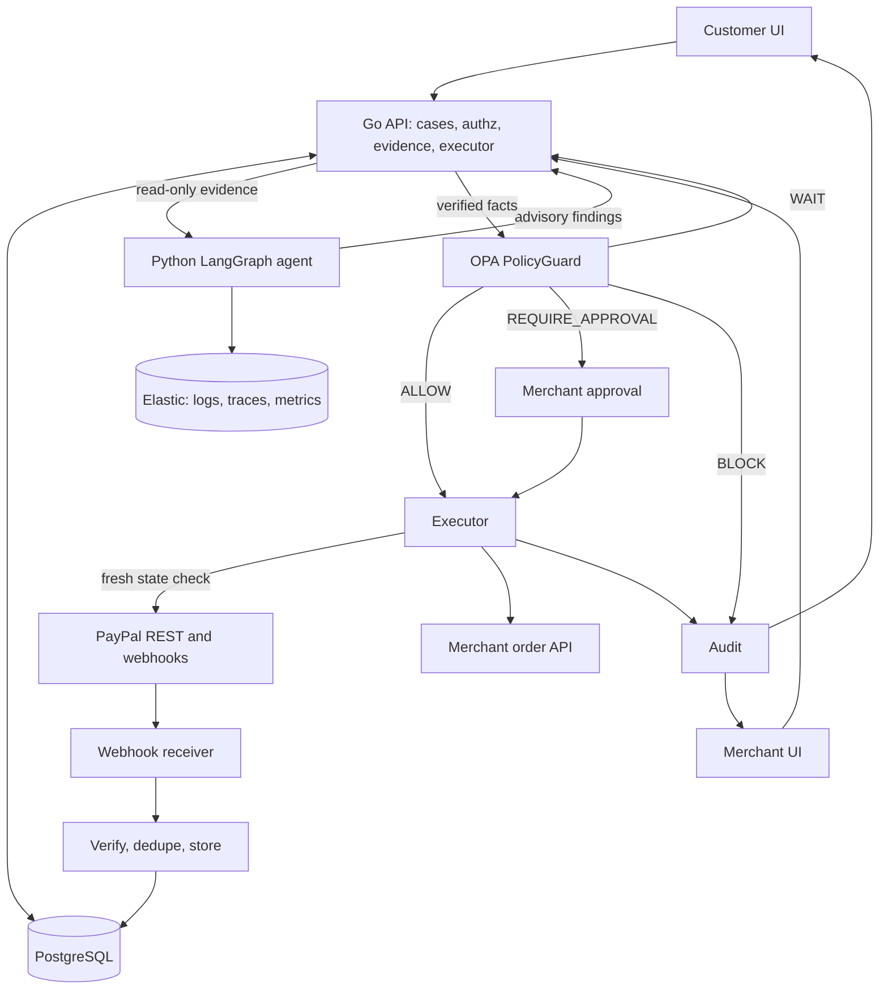

# FRACTAL

**Payments should not become mysteries.**

FRACTAL is a shared payment-exception resolution platform. When a payment's provider state, the merchant's order state and the customer's experience disagree, FRACTAL gives the customer and the merchant **one shared case**, investigates the evidence with AI, verifies the facts independently, applies deterministic policy, and coordinates a safe, traceable resolution.

> **AI investigates. Backend verifies. Policy governs. Backend executes. Everything is audited.**

Built for the *Build What's Next with PayPal and AI* hackathon. PayPal Sandbox is the primary provider.

**Status:** in development. The commands and endpoints below describe the target local workflow. See [`docs/FRACTAL_Development_Plan.md`](docs/FRACTAL_Development_Plan.md) for phase-by-phase progress.

---

## The problem

1. A customer pays through PayPal checkout.
2. PayPal captures the payment and sends a webhook.
3. The merchant's webhook handler fails, so the order stays `PAYMENT_PENDING`.
4. The customer sees "paid". The merchant sees "unpaid". Nobody shares the same facts.

| System | State | Meaning |
|---|---|---|
| PayPal | `COMPLETED` | Provider reports a successful capture |
| Merchant | `PAYMENT_PENDING` | Order was never updated |
| FRACTAL | `INVESTIGATING` | One shared case is open |

## What FRACTAL does

- **One shared case ID** for customer and merchant, with role-specific views of the same case.
- **Verified evidence:** PayPal state, merchant order state, verified webhook history, and case-scoped logs and traces from Elastic, all with provenance.
- **AI investigation:** a single LangGraph agent with read-only tools produces an evidence-cited diagnosis and a plain-language explanation.
- **Independent verification:** the Go backend re-fetches critical facts and builds the policy input itself. Agent claims are advisory only.
- **PolicyGuard (OPA):** deterministic decisions: `ALLOW`, `REQUIRE_APPROVAL`, `WAIT`, `BLOCK`, each with rule IDs and a policy revision.
- **Safe execution:** per-case locking, idempotency keys, fresh-state checks and human approval for sensitive actions.
- **Audit trail:** append-only, hash-chained events with customer-visible and merchant-only visibility.

## What FRACTAL is not

Not a payment gateway or processor, not a fraud system, not a generic support chatbot, and not a replacement for PayPal. The provider stays authoritative for provider-side transaction status.

---

## Architecture



### Trust boundary

```text
 ADVISORY (untrusted)                 AUTHORITATIVE (trusted)
 +----------------------+            +-----------------------------+
 | LangGraph agent      |  advice    | Go backend                  |
 | - findings           | ---------> | - re-fetch PayPal state     |
 | - recommendation     |            | - re-read order state       |
 | - suggested severity |            | - verify webhooks           |
 +----------------------+            | - build OPA input           |
                                     +--------------+--------------+
                                                    | verified facts
                                                    v
                                     +-----------------------------+
                                     | OPA / Rego PolicyGuard      |
                                     | ALLOW | REQUIRE_APPROVAL    |
                                     | WAIT  | BLOCK               |
                                     +--------------+--------------+
                                                    v
                                     Executor: lock, idempotency,
                                     fresh check, execute, audit
```

A hallucinating agent cannot cause an action because its claims never reach the policy engine as facts, and the agent holds no payment credentials.

### Tech stack

| Area | Technology |
|---|---|
| Core backend | Go modular monolith, calls PayPal REST directly (no SDK, no adapter service) |
| AI service | Python, FastAPI, LangGraph, Pydantic |
| Policy | Open Policy Agent, Rego |
| Database | PostgreSQL |
| Observability | OpenTelemetry to Elastic (Elasticsearch, Kibana) |
| Frontend | React, TypeScript, Vite |
| Mock merchant | Small storefront with a breakable webhook handler |
| Local orchestration | Docker Compose, Makefile |

---

## Quick start (local)

### Prerequisites

- Docker and Docker Compose
- Go, Node.js and Python (only needed if you run services outside containers)
- A PayPal Developer account with a Sandbox app and two Sandbox accounts (a business merchant and a personal buyer)
- A tunnel tool (`cloudflared` or `ngrok`) so PayPal can reach your local webhook receiver
- An API key for your chosen LLM provider (set through environment variables)
- Several GB of free RAM for single-node Elasticsearch

### 1. Configure

```bash
git clone <your-repo-url> fractal
cd fractal
cp .env.example .env
```

Fill in `.env`:

| Variable | Purpose |
|---|---|
| `PAYPAL_CLIENT_ID`, `PAYPAL_CLIENT_SECRET` | Sandbox app credentials |
| `PAYPAL_WEBHOOK_ID` | Set after you register the webhook (step 3) |
| `PAYPAL_ENV` | `sandbox` (default and only supported value for local use) |
| `DATABASE_URL` | PostgreSQL connection string |
| `OPA_URL` | OPA server address |
| `ELASTIC_URL`, `ELASTIC_API_KEY` | Elastic endpoint and credentials |
| `LLM_PROVIDER`, `LLM_API_KEY`, `LLM_MODEL` | Agent model configuration |
| `MERCHANT_SIGNING_SECRET` | HMAC secret shared with the mock merchant |
| `JWT_DEV_SECRET` | Dev token signing secret |

Never commit `.env`. Use Sandbox credentials only.

### 2. Start the stack

```bash
make up        # postgres, opa, elasticsearch, kibana, api, investigator, merchant-store, web
make migrate   # apply database migrations
make seed      # users, merchant, provider account, products, policy bundle record
```

### 3. Expose and register the webhook

```bash
cloudflared tunnel --url http://localhost:8080   # or: ngrok http 8080
```

In your PayPal Sandbox app, add a webhook pointing to:

```text
https://<your-tunnel-host>/api/v1/webhooks/paypal/<provider_account_id>
```

Copy the webhook ID into `PAYPAL_WEBHOOK_ID` and restart the API. Re-register when the tunnel URL changes.

### 4. Open the apps

| App | URL |
|---|---|
| FRACTAL web (customer and merchant) | http://localhost:5173 |
| Mock merchant store | http://localhost:8090 |
| Demo control panel | http://localhost:5173/demo |
| Kibana (optional) | http://localhost:5601 |

Seeded dev users (change in `scripts/seed`): one customer, one merchant admin, one merchant staff, one platform admin. Use the role switcher on the login page.

---

## Run the demo

1. On the mock store, set the merchant handler to **Broken** (or use `/demo`).
2. Pay through PayPal Sandbox. The order stays `PAYMENT_PENDING`.
3. As the customer, open a case with the order reference and the claim code shown on the confirmation page.
4. As the merchant, review the evidence, the Elastic log, the AI diagnosis and the PolicyGuard decision, then reconcile.
5. Try the negative cases from `/demo`: invalid-signature webhook, amount mismatch, refund without approval.
6. Fire 50 concurrent webhook replays. Exactly one action executes.
7. Open the audit timeline and run the hash-chain verification.

```bash
make demo   # scripted happy path plus negative scenarios
```

---

## Roles and visibility

| Item | Customer | Merchant staff | Merchant admin | Platform admin |
|---|---|---|---|---|
| Case, payment, order status | Yes | Yes | Yes | Read for audit |
| Provider order and capture IDs | No | Yes | Yes | Yes |
| AI findings | Simplified | Detailed | Detailed | Detailed |
| Evidence, Elastic logs and traces | No | Case-scoped | Case-scoped | Yes |
| Policy decision | Plain reason | Rules and findings | Rules and findings | Yes |
| Raw policy input, anomaly score | No | No | Yes | Yes |
| Audit timeline | Customer-visible | Customer and merchant-only | Customer and merchant-only | Full |
| Approve refund | No | No | Yes, not own request | No |
| Edit policy bundles | No | No | No | Yes |

A case ID is never a credential. Every request is checked for object-level access, and non-parties receive 404.

---

## Policy (PolicyGuard)

- Policies live in `policies/` as Rego modules, plus data files for thresholds, the action registry, merchant overrides and jurisdiction pack flags.
- Every rule module emits **findings**. A single aggregator applies fixed precedence: `BLOCK` over `WAIT` over `REQUIRE_APPROVAL` over `ALLOW`. `ALLOW` requires every gate listed for the action to pass.
- Go builds the input from facts it fetched itself. Agent output sits under `advisory` and no allow logic may read it (enforced in CI).
- Missing input, unknown action, unknown policy revision, or an OPA failure results in `BLOCK`. The system fails closed.
- Jurisdiction packs (for example US Regulation E, EU PSD2) are **disabled by default** and may only be enabled after qualified legal review.

```bash
make policy-test    # opa test, opa check --strict, opa fmt, advisory isolation, registry lint
```

---

## Development

### Repository layout

```text
fractal/
  api/                Go modular monolith (cases, auth, provider, webhook, evidence, risk, policy, executor, audit)
  investigator/       Python LangGraph service
  merchant-store/     Mock merchant with breakable webhook handler
  policies/           Rego modules, data, tests
  web/                React customer and merchant UI
  scripts/            seed, replay, load test
  docs/               Master document, spec, development plan
  docker-compose.yml
  Makefile
```

### Common commands

```bash
make up            # start all services
make down          # stop all services
make migrate       # run migrations
make seed          # seed dev data
make test          # Go, Python and web unit tests
make policy-test   # OPA tests and policy lint
make e2e           # end-to-end and negative scenario suite
make demo          # scripted demo flow
make reset         # wipe local data
```

### Testing

| Layer | What is checked |
|---|---|
| Policy | Positive and negative fixtures, advisory isolation, registry lint |
| Go | Authorization, projections, state machine, signature verification, idempotency |
| Integration | Dedup, advisory locks, append-only triggers, audit chain on a real PostgreSQL |
| Concurrency | 50 webhook replays and 20 parallel action requests produce one execution |
| Agent | Seeded scenarios, fabricated-evidence rejection, prompt-injection attempts |
| End to end | Happy path plus the negative scenario suite |

---

## Security notes

- PayPal Sandbox only. No live credentials.
- Webhooks are verified before storage. Invalid events go to `security_events` and never into `webhook_events`.
- Deduplication on `(provider, provider_event_id)` and idempotency keys on every action.
- The agent has read-only evidence tools and no PayPal credentials.
- Customer free text is treated as untrusted input to the agent.
- Secrets are stored by reference, never in the database or the repository.
- Evidence, policy decisions and audit events are append-only.
- FRACTAL stores identifiers, statuses and evidence references, not card data. Assess PCI scope before any production use.

---

## Documentation

| Document | Contents |
|---|---|
| [`docs/FRACTAL_Master_Document.md`](docs/FRACTAL_Master_Document.md) | Product definition, architecture, decisions, demo scenario |
| [`docs/FRACTAL_PolicyGuard_Schema_API_Spec.md`](docs/FRACTAL_PolicyGuard_Schema_API_Spec.md) | OPA design, PostgreSQL schema, API contracts |
| [`docs/FRACTAL_Development_Plan.md`](docs/FRACTAL_Development_Plan.md) | Phases, wireframes, compliance references, testing strategy |

External references: [PayPal Webhooks](https://developer.paypal.com/api/rest/webhooks/), [Open Policy Agent](https://www.openpolicyagent.org/docs/latest/), [OWASP API Security](https://owasp.org/www-project-api-security/), [PCI Security Standards Council](https://www.pcisecuritystandards.org/), [LangGraph](https://langchain-ai.github.io/langgraph/), [OpenTelemetry](https://opentelemetry.io/docs/).

---

## Roadmap

- **Core:** shared case, verified webhooks, evidence pipeline, AI investigation, PolicyGuard, idempotent execution, web UI.
- **Optional:** operational anomaly detection that can only tighten decisions; proactive reconciler; root-cause grouping across cases.
- **Later:** additional providers behind the `Provider` interface, legally reviewed jurisdiction packs, production hardening.

## Known limitations

- Sandbox only; Sandbox behavior can differ from live PayPal.
- Anomaly models, if built, train on synthetic data plus your own Sandbox runs.
- No jurisdiction policy pack is enabled. FRACTAL makes no regulatory compliance claims.
- The mock merchant stands in for a real merchant integration. Real merchants must implement the merchant integration contract in the spec.

## Contributing

Issues and pull requests are welcome. Run `make test`, `make policy-test` and `make e2e` before opening a PR. New actions must be registered in `policies/data/actions.json` with required gates and tests.

## License

*FRACTAL is an engineering and product project. It is not legal advice, a compliance certification, or a determination that any regulation applies to a particular merchant, provider or transaction. Regulatory policy packs must be validated by qualified legal and compliance professionals before production use.*